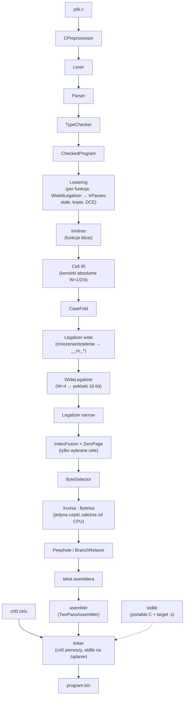
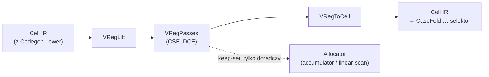
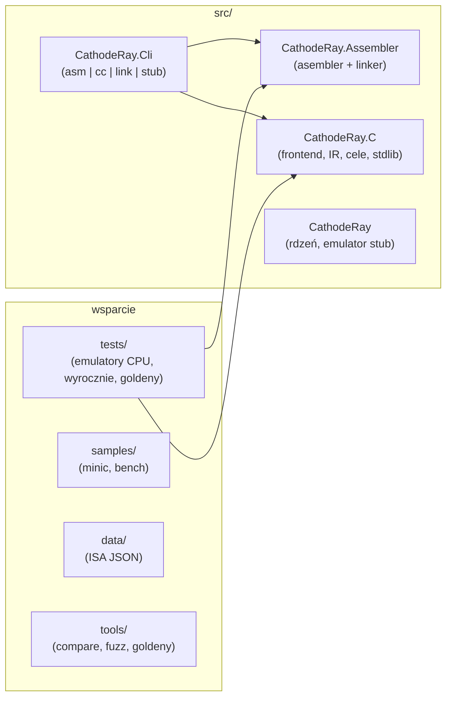
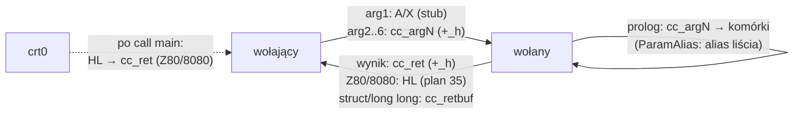

# Architektura kompilatora — szkic graficzny

Opis słowny: [architecture.md](architecture.md). Status: [mini-c-status.md](mini-c-status.md).

## 1. Potok kompilacji (`cathode cc`)

Ścieżka `--ir vreg` ([VRegPipeline.cs](../../src/CathodeRay.C/VReg/VRegPipeline.cs)) nie jest osobnym frontem:
owija `Codegen.Lower` i wraca do tego samego Cell IR (cały dalszy potok bez zmian).

## 2. Moduły repozytorium

Zależności jednokierunkowe: frontend C nie zależy od asemblera, asembler nie zależy od emulatorów.

## 3. ABI v1 — przepływ argumentów i wyniku (cele bajtowe)

Wyjątki: `long` dokłada `cc_rethi`, `long long`/struktury jadą przez adres/bufor.
ABI v2 (argumenty w rejestrach, pilot `nes`, flaga `--abi`): [../ir-vreg-abi/abi-v2-design.md](../ir-vreg-abi/abi-v2-design.md).
